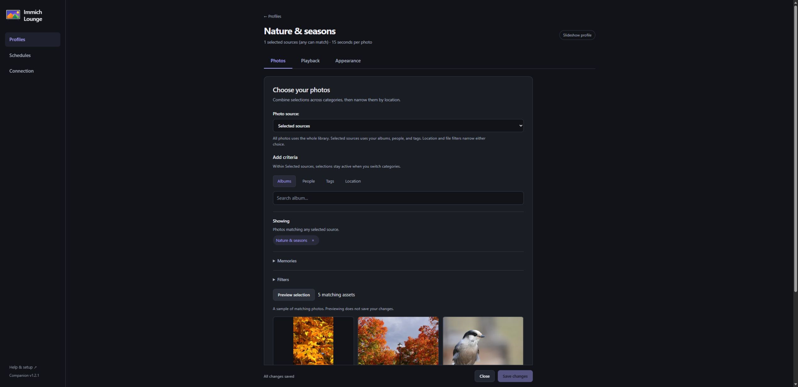

# Using the Companion

This page covers the day-to-day companion web app after the initial connection to immich is already set up.

For install and first-run setup, see [Getting Started](./getting-started.md) and [Installation](./installation.md).

## Connection page

The Connection page stores the shared immich connection used by every profile.

Use it when you need to:

- update the immich server URL
- replace the API key
- save the entered settings and verify access with **Save & Test Connection**

**Save without testing** stores the settings without testing. **Save & Test Connection** stores them first, then checks access to Immich. A failed test does not undo the saved settings.

If you need to generate or rotate the key, see [Immich API Key](./api-key.md).

The page includes key creation instructions and an expandable permission list. After a successful connection test, follow **Next: create or choose a profile**.

{ .doc-screenshot .on-glb }

The connection page is the one shared integration point between the companion and immich.

## Profiles page

The Profiles page is the main hub for ongoing changes.

Use it when you want to:

- create a new profile for a room, use case, or screensaver
- edit an existing profile
- remove a profile you no longer need
- compare which profiles exist before switching the Roku to a different one

When there are no profiles yet, choose **Create a Profile**. Enter a name; the companion generates a profile ID automatically. Use **Customize profile ID** if you want a different ID or the generated one is already in use.

**Refresh Playlist** requests a rebuild for one profile; **Refresh All Playlists** requests it for every profile. The confirmation means the request was accepted, not that the background rebuild has finished.

Deleting a profile requires confirmation. It removes the companion profile, not your Immich photos. Update any schedule or Roku selection that refers to the deleted profile.

{ .doc-screenshot .on-glb }

Profiles are where most day-to-day tuning happens after setup is complete.

## Profile editor

Each profile controls both what the Roku shows and how playback should feel.

Use **Photos** to choose your library content, **Playback** to set the pace and fit, and **Appearance** to choose the background and on-screen information. Only one view is shown at a time. Switching views keeps your unsaved changes.

Choose a **Photo source**: **All photos**, **Selected sources**, or **Memories only**. Within Selected sources, the **Albums**, **People**, and **Tags** tabs keep your selections active when you switch categories. **Any selection** combines them; **Every selection** requires all of them to match. **Location** narrows your selection and memories; filled country, state, and city fields must all match. The **Showing** summary lists the selection, memory priority, and restrictions.

Source matching, **Only photos with people** (Immich 3.2+), exclusions, and file size are under **Filters**. The people-only option includes unnamed detected faces and applies to memories and shared albums too. See [Only photos with people](configuration.md#only-photos-with-people) for setup and detection limits. Memory types, **Prioritize memories**, and the time zone are under **Memories**. Priority shows matching memories first without duplicates. Refresh timing and transition duration are under **More playback options**. Weather and custom date formats are under **Appearance**.

Choose **Preview selection** to see the matching count and up to six sample photos without saving. Changing photo criteria clears the old preview. If a thumbnail cannot load, the count remains available.

Profiles with advanced API-defined rules keep those rules; source matching controls are available only for editable album, people, and tag selections.

The save bar shows whether changes are pending. Choose **Save changes** to keep them, or **Close** to return to Profiles. If you keep editing while a save is pending, the editor stays open and keeps the newer edits marked as unsaved. Save again to keep those edits. Leaving with unsaved changes requires confirmation. If the companion restarts and your session expires, choose **Reload page** in the recovery dialog; unsaved edits may be lost.

You can edit display settings before connecting Immich. Follow **Configure connection** to enable source selection and match previews. If sources cannot load, check the connection and use the picker’s retry button; the rest of the editor remains usable.

| Area | What you manage there |
|---|---|
| Photos | All photos, selected sources, or memories only; memory priority, location, and file filters |
| Playback | Interval, shuffle, transitions, photo motion, and refresh timing |
| Appearance | Photo details, backgrounds, clock, date formatting, weather, and image quality |

{ .doc-screenshot .on-glb }

The profile editor separates photos, playback, and appearance into focused views.

## Schedules page

Schedules choose which profile plays at different times; profiles still hold the photos and display settings.

1. Create the profiles you want to use.
2. Open **Schedules** and choose **New Schedule**.
3. Enter a name, choose the time zone and fallback profile, and add weekly time slots.
4. Save the schedule, then select it on Roku instead of a fixed profile.

The schedule ID is generated from the name. Expand **Customize schedule ID** to change it before saving, including when the generated ID is already in use. Existing schedule IDs stay fixed.

Outside the time slots, the fallback profile plays. Overlapping slots use the first matching row; move rows up to change priority. The channel and screensaver can follow different schedules.

Deleting a schedule keeps its profiles. Choose another schedule or profile on any Roku that used the deleted schedule.

For time-zone, fallback, and offline behavior, see [Schedules](./configuration.md#schedules).

## Typical companion tasks

- make one profile for the main channel and another for the screensaver
- keep a simpler profile for weaker Roku hardware or slower networks
- duplicate a working setup by recreating a similar profile with different albums or people
- update the immich API key in one place when it changes

## What the companion does not do

- Roku fetches slideshow images directly from Immich; the companion only fetches small samples when you preview a selection
- it does not store the API key inside the profile JSON files on disk
- it does not control Roku-side cache clearing or profile switching directly

For Roku playback behavior, remote controls, and the on-device settings menu, see [Using the Roku Apps](./roku-apps.md).
