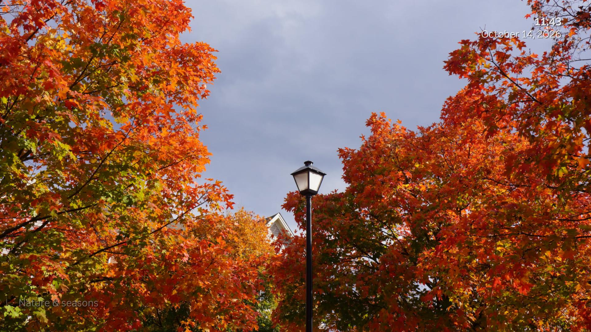
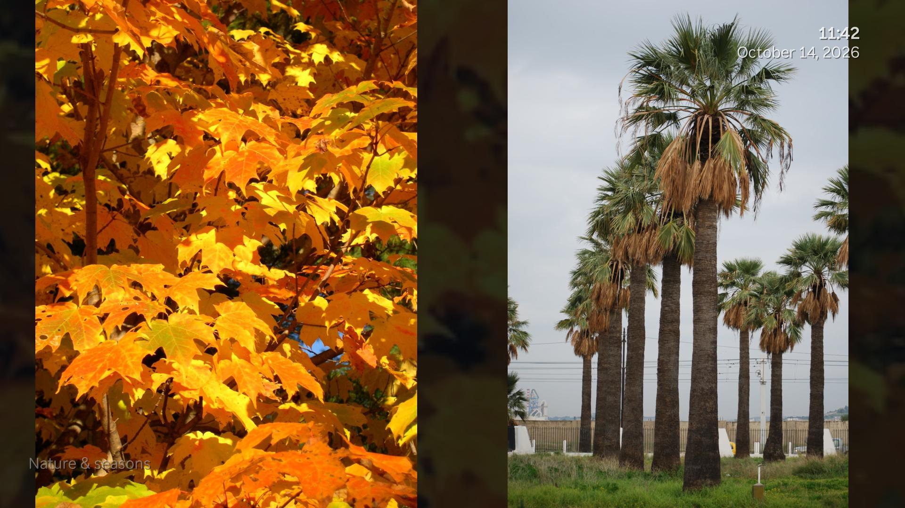
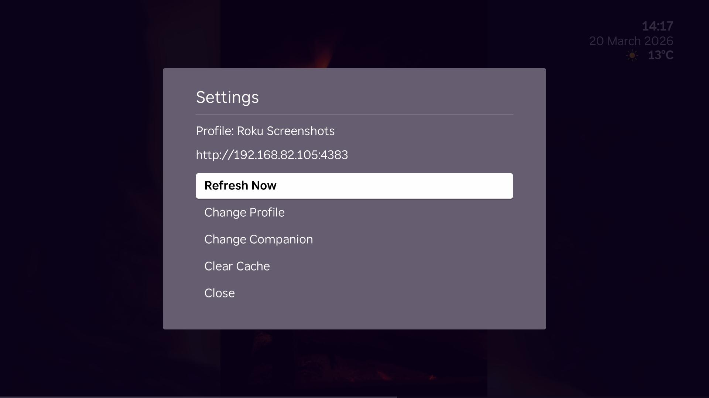

# Configuration

Most users only need three things here: connect the companion to immich, create one or more profiles, and tune how the slideshow should look on Roku.

For the companion pages you use after setup, see [Using the Companion](./companion-app.md).

For channel controls, profile switching on the Roku, cache clearing, and screensaver behavior after setup, see [Using the Roku Apps](./roku-apps.md).

## Connection settings

These settings are shared by every profile:

- immich server URL
- immich API key

Use an immich URL that the Roku can reach on your LAN. `localhost`, `127.0.0.1`, `::1`, and wildcard bind addresses are not valid here.

Use **Save & Test Connection** to save the settings and check that the companion can reach Immich. Settings stay saved even if the test fails. The result also shows the server version and selected search API. Immich Lounge selects Search API v2 for stable Immich 3.2+ servers and legacy search for older servers. If version detection is unavailable, it uses legacy search with the same filters.

Detection refreshes automatically after five minutes; **Save & Test Connection** refreshes it immediately. No settings or profile migration is needed.

{ .doc-screenshot .on-glb }

The connection page stores the single immich connection used by all profiles.

> **Security note:** The companion is for trusted home networks. It does not provide public-internet authentication.

## Profiles

A profile decides what to show and how to show it. You can create as many as you want.

New profiles created in the companion start with **Overlay Behavior** set to **Always On** and **Show Progress Timer** off. You can change both in the profile editor. Existing profiles keep their saved settings.

After changing a profile's content sources, **Preview Match Count** uses the new selection. Save the profile to apply it to the playlist when the Roku next refreshes it.

Saving a profile or connection settings clears the affected companion playlists. Any build already using the previous settings is discarded; the next playlist request builds from the saved settings.

Choose a **Photo source**: **All photos**, **Selected sources**, or **Memories only**. New profiles use All photos. Selected sources requires at least one album, person, or tag; choose **Any selection** to match any of them or **Every selection** to require all of them. Location, date, file size, and **Exclude people (NOT)** narrow the results, including memories.

For example, choose **All photos** and set **Country → Maldives** to show your Maldives photos without selecting albums or people. Enable memories and **Prioritize memories** to put matching memories first.

Older profiles show **Keep current selection** and retain their saved behavior until you choose a photo source. For those profiles, memories alone remain the only source; memories combined with selected albums, people, or tags are added even when they do not match those sources or the date filter.

Profiles with nested content rules created through the API keep those rules when edited in the companion. Their album, people, and tag selectors are unavailable; edit the nested rules through the API. Selecting All photos or Memories only leaves those saved rules inactive. Excluded people, memories, and display settings can still be changed in the companion.

The companion collects all matching result pages and removes duplicates. With **Shuffle** enabled, every matching photo is included, and each Roku gets a fresh randomized order after completing a loop. The Roku fetches photos in windows and keeps the same order during refreshes and resume within that loop. Each device's loop is independent. With **Shuffle** off, choose **Photo order**: **Newest first** (the default) or **Oldest first**. Photos are ordered by their original date. With **Prioritize memories** enabled, this order applies separately to the memories and the remaining photos. The choice is remembered while Shuffle is on, but only applies when Shuffle is off. Offline playback repeats the cached window until the companion is reachable, with a 60-second pause between failed playlist requests.

{ .doc-screenshot .on-glb }

Each profile can target a different room, use case, or screensaver setup.

  

    <h3>Content sources</h3>
    
Build a profile from albums, people, tags, and memories. Sources are combined into one playlist.

  

  

    <h3>Date filters</h3>
    
Limit a profile to a fixed range or a rolling window like the last 6 months.

  

  

    <h3>Slideshow controls</h3>
    
Change interval, shuffle, transitions, photo motion, and playlist refresh timing.

  

  

    <h3>Display settings</h3>
    
Choose overlays, clock and weather, date formatting, and background effects.

  

## What you can configure

| Area | What it covers |
|---|---|
| Content | Albums, people, tags, memories, and optional face, date, and location filtering |
| Playback | Interval, shuffle, transition effect, photo motion, and playlist refresh interval |
| Display | Overlay style and fields, background effect, date and time formatting, weather, and image quality |

### Only photos with people

To show photos containing anyone, without choosing specific people:

1. Open a profile and choose **Photos → Filters**.
2. Enable **Only photos with people**. Leave the People selector empty unless you also want to match particular people.
3. Choose **Preview selection** to check the matching count and sample photos, then save the profile.

This narrows the existing selection to photos with at least one visible detected face. Named and unnamed people count. It applies to the whole library or selected albums, people, and tags, including shared albums and added memories. Date, location, file-size filters, and people exclusions still apply. It works with both the Roku channel and screensaver.

Immich must have processed face detection for each photo. People seen from behind, distant faces, or other missed detections may be skipped. A selection with no detected faces produces an empty playlist.

Requires **Immich 3.2 or later** and is off by default. The companion enables the option after detecting a supported server. If detection is unavailable, use **Save & Test Connection** on the Connection page and reopen the profile. If you change to an older server, turn this filter off; the companion reports an error rather than silently including photos without people.

For API-managed profiles, set the optional top-level field `"onlyPhotosWithPeople": true`. Omitting it or setting it to `false` keeps the existing unfiltered behavior. No specific person IDs or person names are required.

## Shared albums and people

Albums shared with the Immich account used by the companion can be selected. People filters and exclusions also search the selected albums.

People sharing and photo sharing are separate. On Immich 3.3 or later, users in the same cluster group can share person records so their names appear in the People selectors and photo labels. The photos still need to be shared through an album or partner sharing.

To show one person from a shared album:

1. In Immich, share the album with the account whose API key is configured in the companion.
2. Add both users to the same cluster group and share the person with that account.
3. In the profile's **Photos** view, select the album and person.
4. Under **Filters**, choose **Every selection**. **Any selection** includes the whole album as well as other matching photos.

To remove a person from that album instead, select the album and add the person under **Exclude people (NOT)**. Exclusions also apply to added memories.

Person-only profiles use Immich's normal owned/partner library search. Select the shared album as well to include photos shared only through that album.

{ .doc-screenshot .on-glb }

Example fullscreen slideshow with an album label and persistent clock.

When weather is enabled for a profile, you can choose whether the Roku shows temperatures in Celsius or Fahrenheit.

### Memories

If a playlist has regular photos and its memory request temporarily fails, the companion logs a warning and continues with the regular photos until the next refresh. Memory-only profiles retain their existing cache on failure. Permission errors and people-exclusion failures remain errors.

Enable **Include saved memories** to include past memories saved in Immich throughout the year. This requires Immich 3.2 or later and is off by default. Upcoming memories are excluded. Saved birthday photos do not show a birthday caption outside their active daily birthday window. Saved memories follow the same photo source, location, date, people, size, and priority rules as other memories.

Under **Memories**, enable **Include On This Day memories**, **Include birthday memories**, or both. **Memories only** shows just those memories. With **All photos** or **Selected sources**, matching memories stay within your selection. Enable **Prioritize memories** to show them first, followed by the remaining photos without duplicates. If there are no matching memories today, the regular selection still plays.

The **Only photos with people** option, people exclusions, location, and minimum file size filters apply to memories too. Explicit photo sources also apply the date filter to memories; older profiles retain the behavior described above.

Birthday memories require **Immich 3.3 or later**, a birth date set for the person in Immich, and matching photos from previous birthdays. Immich generates the selection and makes it available from three days before the birthday through the birthday itself. The birthday option is off by default and is unavailable if the companion cannot detect a supported server.

Enable **Show birthday captions** to display the person's birthday alongside the photo date in either overlay style. The caption follows the overlay's visibility setting; an overlay style of **None** hides it. Album labels remain separate. Offline playlists keep the photos but omit birthday captions to avoid showing an outdated birthday message.

Choose a **Memories time zone** to control which day's memories are requested. **Companion time zone** uses the host's time zone; containers often use UTC. The companion checks for a new day every 30 seconds and rebuilds memory playlists even when their normal refresh interval has not elapsed. Profiles using an explicit Photo source also start a fresh shuffle each day when shuffle is enabled. The Roku checks these profiles every minute and adopts a new day's playlist after the current photo finishes, or on resume if paused. Same-day refreshes preserve the current order. Offline playback continues with cached photos until the companion is reachable. This setting does not change the Roku clock or a schedule's time zone.

Saved profile changes replace any waiting daily selection. After upgrading an older Roku package, memory-enabled profiles may start at the beginning of the playlist once; offline startup keeps the cached window.

You can upgrade the companion and Roku separately. An older Roku plays the new companion's selection, including memory priority, using its existing refresh timing. A newer Roku works with an older companion using the companion's existing source behavior. The daily minute checks and changes at photo boundaries require both updated components.

### Zoom to fit

In the profile's **Slideshow** settings, enable **Zoom to fit (landscape photos)** to fill the screen with landscape photos. This preserves the photo's proportions and crops the edges as needed. Portrait and square photos still show the whole image.

The setting is off by default and works in both the channel and screensaver. After the Roku refreshes the profile, it applies to the next photo displayed.

### Location label format

Under **Appearance → Text and overlays**, choose **Location format**: city and country (the default), city/state/province/country, city only, state/province and country, or country only. Both Roku modes use the selected fields from the photo's Immich metadata in bottom and corner overlays. Missing, blank, and repeated values are omitted; if none of the selected fields is available, the location label is hidden. This changes the label text, not which photos match the profile's location filter. Existing profiles keep city and country.

### Transition duration

Set **Transition duration (seconds)** to 0.1–5 seconds, shorter than the photo interval. It controls fade, slide, and zoom transitions in both the channel and screensaver, including portrait-pair fades and background crossfades. **None** changes photos immediately. Existing profiles keep the 0.5-second default; changes apply on the next transition after the Roku refreshes its profile.

### Side-by-side portraits

Enable **Show portrait photos side by side** in the profile's **Slideshow** settings to pair consecutive portrait photos. Both photos are shown in full for one slideshow interval. Landscape, square, and unmatched portrait photos show alone. Pairs stay within the current playlist window and do not cross its boundary.

The channel and screensaver preload the next pair while the current slide is showing. If loading takes longer than the slideshow interval, the current slide stays on screen until the next one is ready.

{ .doc-screenshot .on-glb }

The setting is off by default and works in both the channel and screensaver, including cached playlists. The overlay describes the left photo. Pairs fade together (or switch immediately if transitions are set to None); Ken Burns motion still applies to single photos.

If the right photo cannot load, the left shows alone and the right is retried as the next item. Changes apply to the next photo displayed after the profile refresh.

## Image loading

When an original photo cannot load, Immich Lounge retries its JPEG preview before skipping it. This also covers formats the Roku cannot decode.

## Date filter boundaries

Date ranges configured through the API use UTC calendar days and include the entire final day. Explicit ISO timestamps keep their exact bounds. Empty bounds are omitted.

## Date filter controls

Under **Photos → Filters → Date filter**, choose all dates, a fixed range, or a rolling window of 1–100 days, weeks, months, or years. A range needs at least one bound. Rolling windows are recalculated when the playlist refreshes. Existing profile dates are retained when opening or saving the editor. Date changes invalidate the selection preview.

## Smart search

For **Selected sources**, open **Smart search**, enter terms such as “beach sunset”, then choose **Add search**. Searches combine with albums, people, and tags through **Any selection** or **Every selection**. Date, location, people, and file-size filters still apply. Explicitly selected shared albums are searched too. Immich must have smart search enabled and machine-learning processing completed for those photos.

Immich 3.2 and later return up to 1,000 ranked matches per query and scope (your library plus each explicitly selected album); they currently provide no smart-search pagination. Older supported servers return all numbered result pages. A failed or disabled smart search reports an error rather than substituting the whole library.

## Location filters

In the profile editor, fill in **Country**, **State / province**, or **City** to limit the playlist by location. Suggestions come from locations in your Immich library. Use the exact names stored in Immich; if suggestions are unavailable, you can enter those names manually.

All filled fields must match. Blank fields impose no restriction. For example, a country alone includes all matching locations in that country. A country and city together require both to match. The location filter applies to selected sources and added memories; photos without the required location metadata are excluded.

Location filters work with both legacy search and Search API v2. They use Immich's location metadata, not a distance or radius around a map point. Leave all three fields blank to preserve the existing playlist behavior.

## Profile planning

The channel and screensaver share the same companion URL, but they can use different profiles.

That means you can:

- use the same profile for both
- give the screensaver its own profile
- keep the normal channel tuned for interactive use and the screensaver tuned for quieter background playback

{ .doc-screenshot .on-glb }

Use the Roku settings menu to refresh, switch profile, change companion, or clear cache.

For the actual Roku-side behavior and menu actions, see [Using the Roku Apps](./roku-apps.md).

## Schedules

Profiles define photos, transitions and display settings. Schedules are separate, reusable objects that choose which profile plays when. Open **Schedules** in the companion, create a named schedule, choose its time zone and fallback profile, then add weekly time slots referencing existing profiles.

On Roku, choose a **Profile** for fixed playback or a **Schedule** for automatic switching. The channel and screensaver can follow different selections. Choosing a fixed profile stops following the schedule until you select the schedule again.

Outside the time slots, the fallback profile plays. Disabling time slots also uses the fallback. Each slot uses its referenced profile's content and display settings. Overlapping slots use the first matching row; use **Move up** to change priority. A schedule can reference profiles, including its fallback profile, but cannot reference another schedule.

Start times are included and end times are excluded. An earlier end time runs into the next day: a Friday 22:00–06:00 slot ends on Saturday morning. Equal start and end times mean 24 hours from the starting day. Slots follow local time in the chosen zone, including daylight saving changes.

Schedules are checked each minute while playback runs. A paused slideshow waits to switch until playback resumes; old queued switches expire and are checked again. If a target playlist is empty or unavailable, the current slideshow continues and the Roku retries. If a referenced profile is deleted, the fallback is used. If both are unavailable, the Roku keeps its cached playback when possible. When the companion is offline, the Roku keeps its last configuration; schedule changes require the companion.

Schedules are saved separately in the companion's `schedules/` data folder. Deleting a schedule does not delete its profiles. If you delete the schedule currently selected on a Roku, choose another schedule or profile on that Roku.
