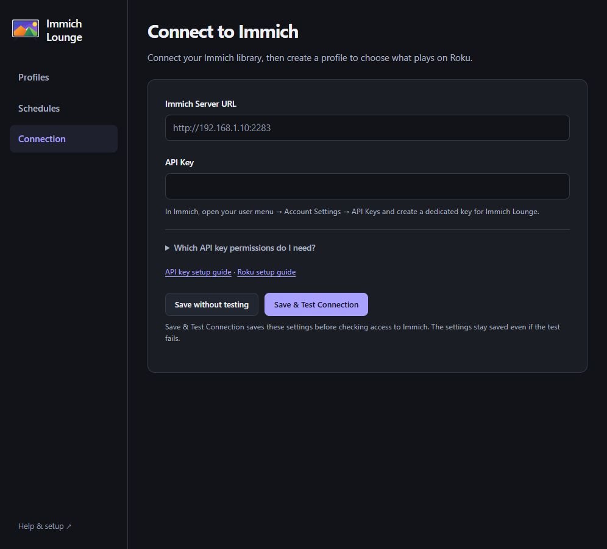
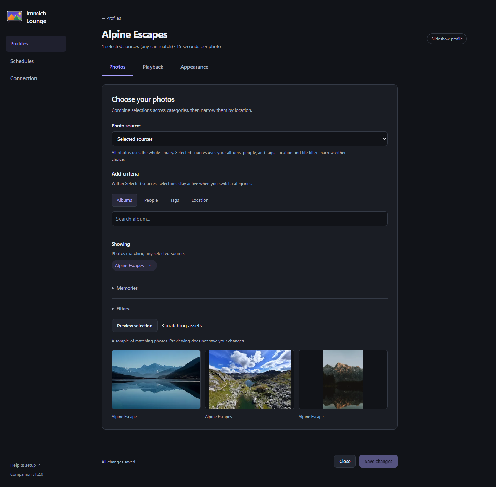
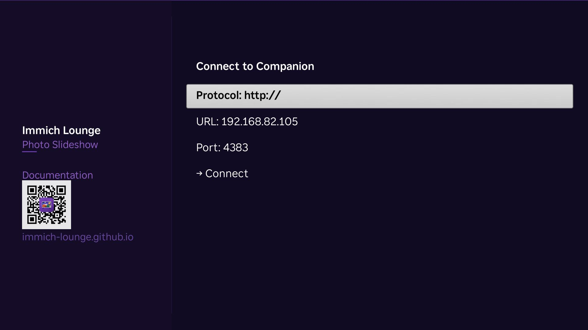
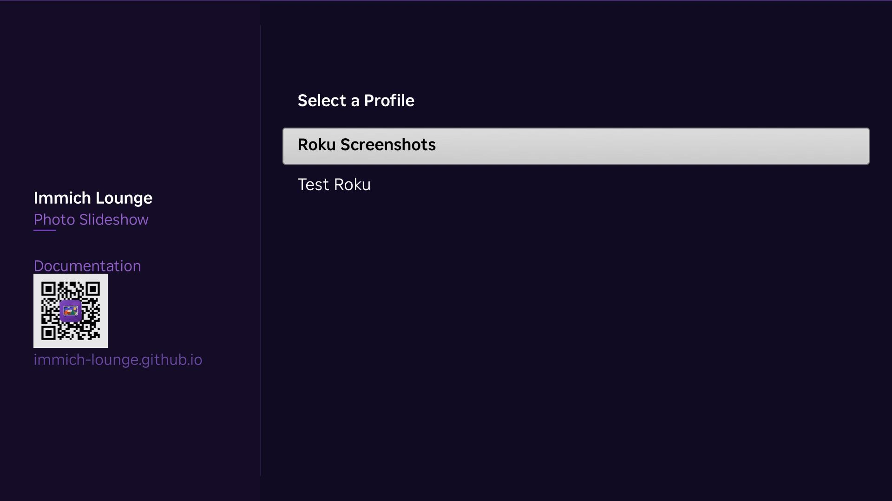

# Getting Started

This is the fastest path to a first working setup.

For a fuller Docker setup reference, Roku install links, and network notes, see [Installation](./installation.md).

You need:

- an **Immich 3.1 or later** server on your LAN
- an **immich API key**
- **Docker** on a machine that stays on
- a **Roku** on the same network

## 1. Start the companion

If you already use Docker Compose for immich, add the companion service from the repo-root `docker-compose.yml`.

```yaml title="docker-compose.yml"
--8<-- "docker-compose.yml"
```

```bash
docker compose up -d
```

This keeps the companion on port `4383` and persists its `/data` directory in a Docker volume.

## 2. Connect the companion to immich

Open:

```text
http://<your-docker-host-ip>:4383
```

On the Connection page, enter:

- your immich server URL, for example `http://192.168.1.10:2283`
- an API key from immich

Do not use `localhost`, `127.0.0.1`, or other loopback-only addresses here. The Roku also needs to reach that immich URL directly.

Click **Save & Test Connection**. This saves the settings before checking access to Immich, even if the connection test fails.

If you have not created the key yet, see [Immich API Key](./api-key.md).

{ .doc-screenshot .on-glb }
<p class="doc-caption">Connect the companion to immich first. The Roku setup comes later.</p>

## 3. Create a profile

A profile decides what the Roku shows and how it should look.

On **Profiles**, click **Create a Profile** or **New Profile** and enter a name, such as “Living Room.” The profile ID is generated from the name; expand **Customize profile ID** if you need a different one.

Pick one or more content sources, then save the profile. The companion starts building the playlist in the background.

{ .doc-screenshot .on-glb }
<p class="doc-caption">A profile controls content, slideshow behavior, overlays, and weather.</p>

## 4. Connect the Roku

Launch **Immich Lounge** on Roku, enter the companion URL, and choose a profile.

For setup help on your phone, scan the QR code under **Setup & support** on the Roku screen.

{ .doc-screenshot .on-glb }
<p class="doc-caption">Enter the companion host and keep the default port <code>4383</code>.</p>

{ .doc-screenshot .on-glb }
<p class="doc-caption">After the Roku reaches the companion, choose the profile you want to use for this device.</p>

If you also want the Roku screensaver, go to `Settings` -> `Theme` -> `Screensavers`, switch to **Immich Lounge Screensaver**, then open **Configure Screensaver**. The full step-by-step flow is in [Using the Roku Apps](./roku-apps.md#change-the-roku-screensaver) and Roku's own help article is [here](https://support.roku.com/article/212015418).

## API key notes

See [Immich API Key](./api-key.md) for the current immich steps to generate a key and the recommended permission set.

Immich Lounge does not create, update, or delete your immich library content.

## Next steps

- Use [Configuration](./configuration.md) to understand the available profile and connection settings.
- Use [Using the Companion](./companion-app.md) for the day-to-day companion pages after setup.
- Use [Using the Roku Apps](./roku-apps.md) for the channel controls, Roku settings menu, and screensaver behavior after setup.
