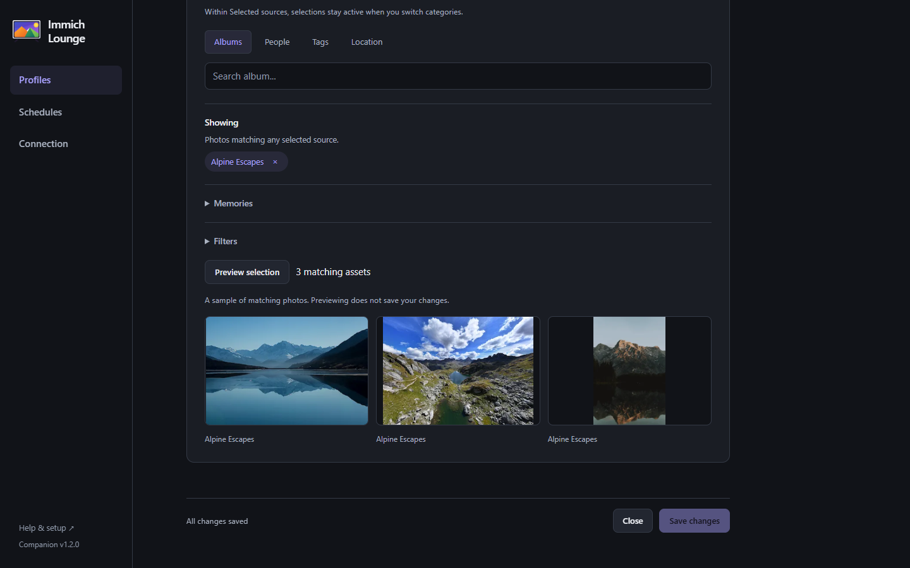
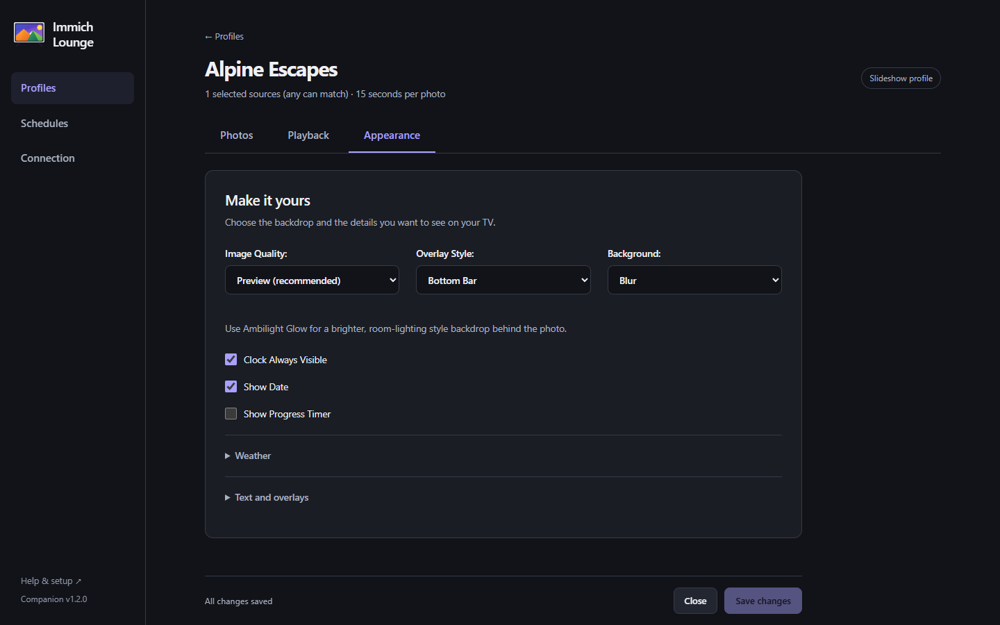
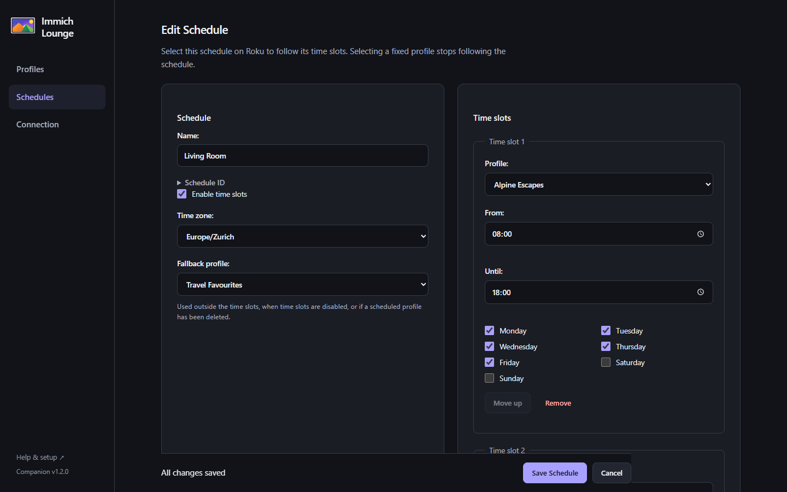

Display your <a href="https://immich.app">Immich</a> photos as a slideshow or screensaver on Roku. A small self-hosted companion lets you choose the photos, tune the display, and schedule different profiles.

  <a class="md-button md-button--primary" href="./getting-started">Get started</a>
  <a class="md-button" href="./installation">Installation</a>
  <a class="md-button" href="https://github.com/immich-lounge/immich-lounge">GitHub</a>

<figure class="screenshot-card home-playback">
  
  <figcaption>Your photos on the TV, with optional photo information, clock, and date.</figcaption>
</figure>

Add the Roku apps to your account:

  <table class="roku-links-table">
    <thead>
      <tr>
        <th>App</th>
        <th>Channel Store</th>
        <th>Add Link</th>
      </tr>
    </thead>
    <tbody>
      <tr>
        <td>Immich Lounge</td>
        <td><a class="roku-link-pill" href="https://channelstore.roku.com/details/b07c35a07c79ab9a68c29c923ac481ce:bdf9083c719f8f235036b2c91bcef535/immich-lounge">Open in Store</a></td>
        <td><a class="roku-link-pill roku-link-pill-secondary" href="https://my.roku.com/account/add/immichlounge">Add to Account</a></td>
      </tr>
      <tr>
        <td>Immich Lounge Screensaver</td>
        <td><a class="roku-link-pill" href="https://channelstore.roku.com/details/1dbc550b0d535eebf60d6fc4b77ec0fb:a6fafa094f6a14e19c10f0bb1e06e315/immich-lounge-screensaver">Open in Store</a></td>
        <td><a class="roku-link-pill roku-link-pill-secondary" href="https://my.roku.com/account/add/immichloungesaver">Add to Account</a></td>
      </tr>
    </tbody>
  </table>

## What you can do

  

    <h3>Choose your photos</h3>
    
Build slideshows from albums, people, tags, and on-this-day memories. Use location filters to focus on a place.

  

  

    <h3>Tune the display</h3>
    
Choose transitions, photo motion, backgrounds, and overlays. Add a clock, date, or weather.

  

  

    <h3>Use profiles and schedules</h3>
    
Keep different photo selections for rooms or occasions. Switch between profiles automatically with weekly schedules.

  

  

    <h3>Keep channel and screensaver separate</h3>
    
Use the same profile for both, or choose different profiles and schedules for each.

  

<figure class="screenshot-card home-playback">
  
  <figcaption>Pair portrait photos side by side and choose a background that suits the room.</figcaption>
</figure>

## Make it your own

  <figure class="screenshot-card">
    
    <figcaption>Choose an album and preview the photos that will play.</figcaption>
  </figure>
  <figure class="screenshot-card">
    
    <figcaption>Choose the background and the details shown on your TV.</figcaption>
  </figure>
  <figure class="screenshot-card">
    
    <figcaption>Keep different photo selections and display settings in named profiles.</figcaption>
  </figure>
  <figure class="screenshot-card">
    
    <figcaption>Switch profiles by time and day, with a fallback for the rest of the week.</figcaption>
  </figure>

## How it connects

Use the companion web app to manage profiles and schedules. The Roku gets its playlist from the companion and loads photos directly from Immich. Cached data helps playback continue through temporary outages.

See [Architecture](./architecture.md) for the technical details.

## Requirements

| Component | Minimum Version |
|-----------|----------------|
| Immich | 3.1 |
| Roku OS | 15.0 |
| Docker | 24.0 (for companion) |

Immich 3.1 or later is supported. Birthday memories require Immich 3.3 or later. Older versions may work but are not actively tested.

## Quick Links

  <a class="quick-link" href="./getting-started">Getting Started</a>
  <a class="quick-link" href="./installation">Installation</a>
  <a class="quick-link" href="./configuration">Configuration</a>
  <a class="quick-link" href="./companion-app">Using the Companion</a>
  <a class="quick-link" href="./roku-apps">Using the Roku Apps</a>
  <a class="quick-link" href="./troubleshooting">Troubleshooting</a>
  <a class="quick-link" href="./support">Support</a>

