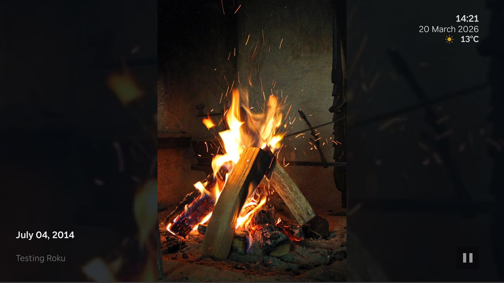

Display your <a href="https://immich.app">Immich</a> photos as a slideshow or screensaver on Roku. A small self-hosted companion lets you choose the photos, tune the display, and schedule different profiles.

  <a class="md-button md-button--primary" href="./getting-started">Get started</a>
  <a class="md-button" href="./installation">Installation</a>
  <a class="md-button" href="https://github.com/immich-lounge/immich-lounge">GitHub</a>

<figure class="screenshot-card home-playback">
  
  <figcaption>Your photos on the TV, with optional information, clock, and weather.</figcaption>
</figure>

Add the Roku apps to your account:

  <table class="roku-links-table">
    <thead>
      <tr>
        <th>App</th>
        <th>Channel Store</th>
        <th>Add Link</th>
      </tr>
    </thead>
    <tbody>
      <tr>
        <td>Immich Lounge</td>
        <td><a class="roku-link-pill" href="https://channelstore.roku.com/details/b07c35a07c79ab9a68c29c923ac481ce:bdf9083c719f8f235036b2c91bcef535/immich-lounge">Open in Store</a></td>
        <td><a class="roku-link-pill roku-link-pill-secondary" href="https://my.roku.com/account/add/immichlounge">Add to Account</a></td>
      </tr>
      <tr>
        <td>Immich Lounge Screensaver</td>
        <td><a class="roku-link-pill" href="https://channelstore.roku.com/details/1dbc550b0d535eebf60d6fc4b77ec0fb:a6fafa094f6a14e19c10f0bb1e06e315/immich-lounge-screensaver">Open in Store</a></td>
        <td><a class="roku-link-pill roku-link-pill-secondary" href="https://my.roku.com/account/add/immichloungesaver">Add to Account</a></td>
      </tr>
    </tbody>
  </table>

## What you can do

  

    <h3>Choose your photos</h3>
    
Build slideshows from albums, people, tags, and on-this-day memories. Use location filters to focus on a place.

  

  

    <h3>Tune the display</h3>
    
Choose transitions, photo motion, backgrounds, and overlays. Add a clock, date, or weather.

  

  

    <h3>Use profiles and schedules</h3>
    
Keep different photo selections for rooms or occasions. Switch between profiles automatically with weekly schedules.

  

  

    <h3>Keep channel and screensaver separate</h3>
    
Use the same profile for both, or choose different profiles and schedules for each.

  

## In Action

  <figure class="screenshot-card">
    
    <figcaption>Configure the companion with your immich server URL and API key.</figcaption>
  </figure>
  <figure class="screenshot-card">
    
    <figcaption>Select a profile on the Roku after connecting to the companion.</figcaption>
  </figure>
  <figure class="screenshot-card">
    
    <figcaption>Refresh, switch profile, change companion, or clear cache from the Roku menu.</figcaption>
  </figure>

## How it connects

Use the companion web app to manage profiles and schedules. The Roku gets its playlist from the companion and loads photos directly from Immich. Cached data helps playback continue through temporary outages.

See [Architecture](./architecture.md) for the technical details.

## Requirements

| Component | Minimum Version |
|-----------|----------------|
| immich | v2.0 |
| Roku OS | 15.0 |
| Docker | 24.0 (for companion) |

## Quick Links

  <a class="quick-link" href="./getting-started">Getting Started</a>
  <a class="quick-link" href="./installation">Installation</a>
  <a class="quick-link" href="./configuration">Configuration</a>
  <a class="quick-link" href="./companion-app">Using the Companion</a>
  <a class="quick-link" href="./roku-apps">Using the Roku Apps</a>
  <a class="quick-link" href="./troubleshooting">Troubleshooting</a>
  <a class="quick-link" href="./support">Support</a>

